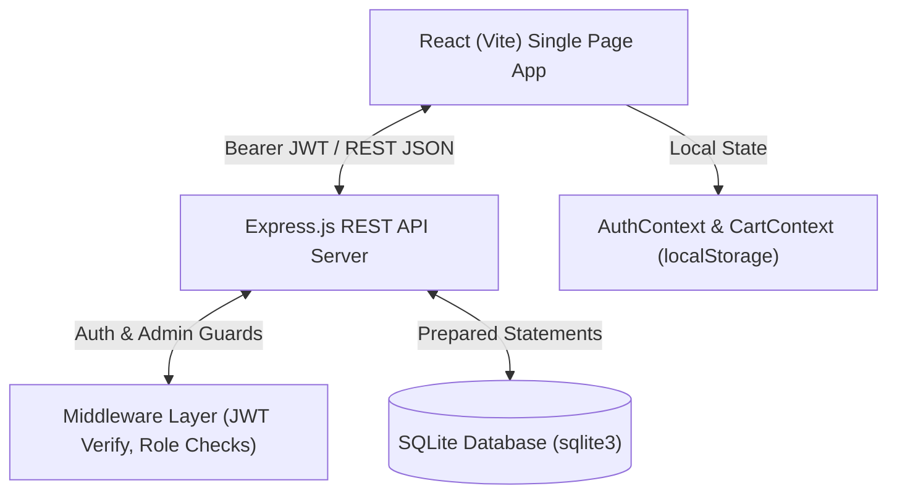

<div align="center">

# 🛍️ AetherShop — Full-Stack SERN E-Commerce Platform

[-blue?style=for-the-badge)](https://github.com)
[](https://react.dev/)
[](https://nodejs.org/)
[](https://www.sqlite.org/)
[](https://jwt.io/)
[](LICENSE)

*A high-performance, dark-mode-first hardware and electronics e-commerce store engineered with the **SERN Stack** (SQLite, Express, React, Node.js). Features role-based access control (RBAC), atomic transactional stock management, persistent cart state, and an interactive admin telemetry dashboard.*

[Features](#-key-features) • [Architecture](#-architecture) • [Getting Started](#-getting-started) • [API Reference](#-api-endpoints) • [Database Schema](#-database-schema) • [Placement Talking Points](#-interview--placement-talking-points)

</div>

---

## 📸 Overview & Highlights

AetherShop is built specifically to demonstrate clean separation of concerns, transactional reliability, and responsive UI design without bulky third-party CSS frameworks. 

- **Frontend**: React (Vite SPA) + Native CSS3 (Glassmorphism & CSS Variables)
- **Backend**: Node.js & Express REST API with modular middleware
- **Database**: SQLite3 with auto-initialization and automated mock dataset seeding
- **Authentication**: Stateless JSON Web Tokens (JWT) & `bcryptjs` password hashing

---

## ✨ Key Features

### 🛒 Customer Experience
- **Interactive Catalog**: Real-time multi-category filtration (Laptops, Audio, Wearables, Displays, Phones, Accessories), live keyword search with debouncing, and price sorting.
- **Dynamic Spec Sheet**: Product detail views featuring real-time stock alerts, quantity picker with upper-limit inventory clamping, and value props.
- **Cart Management**: Persistent shopping cart synced with browser `localStorage`, dynamic subtotal calculations, and item counter badges.
- **Atomic Checkout**: Direct checkout simulation that verifies real-time stock availability in the database and updates inventory counters transactionally upon order placement.
- **Order History Ledger**: Dedicated view for customers to review past orders, items purchased, prices locked at purchase time, and live shipment tracking statuses.

### 🛡️ Admin & Store Operations
- **Executive Analytics Dashboard**: Telemetry widgets tracking Total Revenue, Active Orders, Registered Clients, and Catalog size.
- **Low-Stock Detection**: Real-time alerts highlighting products with fewer than 5 units left.
- **Revenue by Category Breakdown**: Visual progress bars showing relative sales contribution per hardware sector.
- **Full Product CRUD**: Add new products, edit pricing/stock/descriptions, and deprovision products with modal dialogues.
- **Order Fulfillment Controls**: Real-time shipment status switcher (`pending` ➔ `shipped` ➔ `completed` ➔ `cancelled`).

---

## 🏛 Architecture & Tech Stack



### The SERN Stack:
| Layer | Technology | Role |
|---|---|---|
| **S** | **SQLite3** | Zero-setup relational embedded SQL database engine. Perfect for reliable local testing and ACID transaction compliance. |
| **E** | **Express.js** | Lightweight Node.js web application framework powering RESTful routes, middleware, and request validation. |
| **R** | **React (Vite)** | Modern component-driven Single Page Application (SPA) with Context API for state management. |
| **N** | **Node.js** | Asynchronous, event-driven JavaScript runtime environment executing backend logic. |

---

## 📂 Repository Structure

```text
ecommerce-platform/
├── backend/
│   ├── db.js                 # SQLite connection, Promise wrappers, table migrations & seeds
│   ├── server.js             # Express app, JWT auth middleware, REST route endpoints
│   ├── package.json          # Express, cors, sqlite3, bcryptjs, jsonwebtoken
│   └── database.sqlite       # Relational database file (generated on first boot)
├── frontend/
│   ├── index.html            # HTML shell with meta tags & SEO title
│   ├── package.json          # React, Vite, React Router, Lucide Icons
│   ├── vite.config.js        # Vite build configurations
│   └── src/
│       ├── main.jsx          # Providers (BrowserRouter, AuthProvider, CartProvider)
│       ├── App.jsx           # Main layout router configuration
│       ├── index.css         # Glassmorphic dark-mode CSS design system
│       ├── components/       # Reusable components (Navbar, Footer, ProductCard)
│       ├── context/          # React Contexts (AuthContext, CartContext)
│       └── pages/            # View pages (Home, ProductDetail, Cart, Orders, Admin, Auth)
├── .gitignore                # Root gitignore excluding node_modules, dist, *.sqlite
└── README.md                 # Project documentation
```

---

## 🚀 Getting Started

### Prerequisites
- [Node.js](https://nodejs.org/) (v18.0.0 or higher recommended)
- `npm` or `yarn`

### 1. Clone the Repository
```bash
git clone https://github.com/vinayaksharma264/aethershop-ecommerce.git
cd aethershop-ecommerce
```

### 2. Setup & Start Backend
```bash
cd backend
npm install
npm run dev
```
> The backend will start on **`http://localhost:5000`**.  
> The SQLite database (`database.sqlite`) will automatically initialize and populate with sample hardware products on first boot.

### 3. Setup & Start Frontend
Open a new terminal window:
```bash
cd frontend
npm install
npm run dev
```
> The frontend application will start on **`http://localhost:5173`**.

---

## 🔑 Demo & Test Credentials

The application includes convenient one-click presets on the login screen for testing:

| Role | Email | Password | Access Rights |
|---|---|---|---|
| **Administrator** | `admin@aether.com` | `admin123` | Full Admin Dashboard, Metrics, Product CRUD, Order Status Controls |
| **Customer** | `vinay@example.com` | `password123` | Catalog Browsing, Cart, Checkout, Personal Order Ledger |

*(Note: If registering a new user, any email ending with `@aether.com` or starting with `admin_aether` is automatically granted the `admin` role by the backend).*

---

## 📡 API Endpoints

### 🔐 Authentication (`/api/auth`)
- `POST /api/auth/register` — Register a new customer or admin account
- `POST /api/auth/login` — Authenticate and receive a 24-hour signed JWT
- `GET /api/auth/me` — Fetch current user identity via Bearer token

### 📦 Products (`/api/products`)
- `GET /api/products` — List products (supports `?category=`, `?search=`, and `?sort=`)
- `GET /api/products/:id` — Fetch details for a specific product
- `POST /api/products` — Create a new product *(Admin only)*
- `PUT /api/products/:id` — Update product details or inventory *(Admin only)*
- `DELETE /api/products/:id` — Deprovision a product *(Admin only)*

### 🧾 Orders & Checkout (`/api/orders`)
- `POST /api/orders` — Validate stock, debit inventory, and create order *(Authenticated)*
- `GET /api/orders` — List personal orders (or all customer orders if Admin)
- `PUT /api/orders/:id` — Update order shipment/payment status *(Admin only)*

### 📊 Telemetry & Analytics (`/api/admin`)
- `GET /api/admin/stats` — Aggregate metrics: total revenue, order count, registered users, category distribution, and low-stock alerts *(Admin only)*

---

## 🗄️ Database Schema

```sql
-- Users Table
CREATE TABLE users (
  id INTEGER PRIMARY KEY AUTOINCREMENT,
  name TEXT NOT NULL,
  email TEXT UNIQUE NOT NULL,
  password_hash TEXT NOT NULL,
  role TEXT DEFAULT 'user',
  created_at DATETIME DEFAULT CURRENT_TIMESTAMP
);

-- Products Table
CREATE TABLE products (
  id INTEGER PRIMARY KEY AUTOINCREMENT,
  name TEXT NOT NULL,
  description TEXT NOT NULL,
  price REAL NOT NULL,
  stock INTEGER NOT NULL,
  category TEXT NOT NULL,
  image_url TEXT NOT NULL,
  created_at DATETIME DEFAULT CURRENT_TIMESTAMP
);

-- Orders Table
CREATE TABLE orders (
  id INTEGER PRIMARY KEY AUTOINCREMENT,
  user_id INTEGER REFERENCES users(id),
  total_amount REAL NOT NULL,
  status TEXT DEFAULT 'pending',
  payment_status TEXT DEFAULT 'pending',
  created_at DATETIME DEFAULT CURRENT_TIMESTAMP
);

-- Order Items Table
CREATE TABLE order_items (
  id INTEGER PRIMARY KEY AUTOINCREMENT,
  order_id INTEGER REFERENCES orders(id) ON DELETE CASCADE,
  product_id INTEGER REFERENCES products(id),
  quantity INTEGER NOT NULL,
  price REAL NOT NULL
);
```

---

## 🎯 Interview / Placement Talking Points

When presenting this project during technical interviews, emphasize these design choices:

1. **Why SQLite (SERN stack) over MongoDB or PostgreSQL?**
   - *"SQLite provides full SQL relational capabilities, ACID compliance, and zero-configuration portability. For an interviewer cloning the repository, it works immediately out of the box with zero external database server setup required."*
2. **Preventing Race Conditions & Negative Stock**:
   - Before completing an order, the backend executes an atomic inventory validation loop across all ordered items. If any item's requested count exceeds available stock, the transaction halts and returns a descriptive error before stock is decremented.
3. **Decoupled Pricing (Historical Accuracy)**:
   - Price at the time of purchase is stored separately in the `order_items` table. Even if the store administrator modifies product prices later in `products`, past receipts remain immutable and historically accurate.
4. **JWT Stateless Authentication vs. Server Sessions**:
   - Tokens contain user ID, role, and expiration, allowing authenticated routes to scale horizontally without memory-bound session stores on the server.
5. **Clean Component Architecture**:
   - Global concerns (`AuthContext`, `CartContext`) are decoupled from presentational components, and cart state is automatically mirrored to `localStorage` for cross-tab persistence.

---

## 📄 License
This project is licensed under the MIT License — feel free to use and adapt it for learning, portfolios, or placement showcases!
